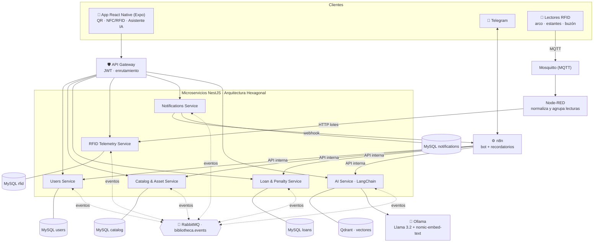

# 📚 Bibliotheca AI — Ecosistema Digital de Bibliotecas con Rastreo RFID y Asistente Virtual

**Área:** Educación · **Frontend:** React Native (Expo) · **Backend:** Microservicios Node.js + TypeScript (NestJS) con Arquitectura Hexagonal · **IA:** RAG + LLM (LangChain, Qdrant, Ollama) · **Automatización:** n8n + Telegram · **IoT:** Node-RED + MQTT

**Autor:** Daniel Núñez Vázquez · **Materia:** Taller de Desarrollo 4 · **Docente:** Luis Alfaro Gutiérrez  
Escuela de Tecnologías Digitales Aplicadas C-1, Benemérita Universidad Autónoma de Chiapas

Bibliotheca AI digitaliza la operación de una biblioteca universitaria:

- Cada libro físico lleva un **código QR** y una **etiqueta RFID**. El celular los lee (cámara o NFC) para hacer **autopréstamo**, devoluciones y alta de etiquetas.
- **Lectores RFID** (arco de seguridad, estantes inteligentes y buzón de devolución) envían lecturas en tiempo real por **MQTT → Node-RED → RFID Telemetry Service**. Así se detectan **salidas no autorizadas**, **devoluciones automáticas** en el buzón y **libros mal ubicados** (inventario automático).
- Un **asistente virtual (RAG)** responde preguntas como *"Busco un libro que hable sobre física cuántica para principiantes"* recomendando solo libros reales del catálogo, con disponibilidad y ubicación, y genera **resúmenes interactivos**.
- Un **bot de Telegram** (orquestado en **n8n**) permite consultar disponibilidad, **renovar préstamos en un clic** y recibir **recordatorios de devolución**.

---

## 1. Arquitectura



El diagrama editable para draw.io está en [`docs/arquitectura.drawio`](docs/arquitectura.drawio) y el detalle técnico (capas hexagonales, secuencias, eventos y modelo de datos) en [`docs/ARQUITECTURA.md`](docs/ARQUITECTURA.md).

| Componente | Tecnología | Puerto | Responsabilidad |
|---|---|---|---|
| API Gateway | NestJS + http-proxy-middleware | **3000** | Valida JWT, elimina cabeceras falsificadas y enruta a cada servicio |
| Users Service | NestJS · MySQL | 3001 | Registro, login JWT, roles, vinculación con Telegram |
| Catalog & Asset Service | NestJS · MySQL | 3002 | Libros, metadatos, ejemplares, etiquetas RFID, inventario y alertas del arco |
| Loan & Penalty Service | NestJS · MySQL | 3003 | Préstamos, devoluciones, renovaciones, cálculo de sanciones, recordatorios |
| RFID Telemetry Service | NestJS · MySQL | 3004 | Ingesta en tiempo real, deduplicación, lectores y latidos |
| Notifications Service | NestJS · MySQL | 3005 | Convierte eventos en mensajes (Telegram vía n8n + bandeja de la app) |
| AI Service | NestJS · LangChain · Qdrant · Ollama | 3006 | Búsqueda semántica, asistente RAG, resúmenes interactivos |
| RabbitMQ | rabbitmq:4-management | 5672 / **15672** | Mensajería asíncrona (exchange *topic* + cola de mensajes muertos) |
| Qdrant | qdrant | **6333** | Base de datos vectorial |
| Ollama | ollama | 11434 | LLM local (Llama 3.2) y embeddings (nomic-embed-text) |
| n8n | n8n | **5678** | Bot de Telegram, notificaciones y recordatorios programados |
| Node-RED + Mosquitto | node-red · eclipse-mosquitto | **1880** / 1883 | Simulador e ingesta de lectores RFID |

Cada microservicio publica su documentación **Swagger** en `http://localhost:300X/docs`.

---

## 2. Requisitos

- **Docker Desktop** (Windows con WSL 2) con al menos **8 GB de RAM** asignados (16 GB recomendado por el LLM).
- **Node.js 20+** solo para la app móvil.
- **Expo Go** en tu celular (Android/iOS) **o** un emulador Android.
- (Opcional) Una cuenta de **Telegram** para el bot.

---

## 3. Puesta en marcha (backend completo)

```powershell
# 1. Variables de entorno: copia la plantilla y escribe el token de tu bot
copy .env.example .env

# 2. Levantar todo el ecosistema
docker compose up -d --build

# 3. Ver el estado (espera ~1-2 min la primera vez)
docker compose ps
```

La **primera vez** Docker descarga imágenes y el contenedor `ollama-init` descarga los modelos (~2.3 GB). Puedes seguir el avance con:

```powershell
docker compose logs -f ollama-init
```

Verifica que todo esté arriba en **http://localhost:3000/health** (todos los servicios deben decir `"up"`).

Al arrancar, cada servicio crea sus tablas y **datos de demostración**: 32 libros, 66 ejemplares con etiqueta RFID, 7 lectores, 5 usuarios y 2 préstamos (uno por vencer y uno vencido). El AI Service indexa el catálogo en Qdrant automáticamente cuando Ollama termina de descargar los modelos.

> 💡 **¿Tu equipo es modesto?** Instala [Ollama para Windows](https://ollama.com/download), ejecuta `ollama pull llama3.2:3b` y `ollama pull nomic-embed-text`, y en `.env` cambia `OLLAMA_BASE_URL=http://host.docker.internal:11434`. Usará tu GPU directamente.

### Cuentas iniciales

| Rol | Nombre | Correo | Contraseña |
|---|---|---|---|
| Dirección (admin) | Roberto Salinas Cruz | `direccion@bibliotheca.edu.mx` | `Dir#Bibl2026` |
| Personal de biblioteca | Laura Méndez Ortiz | `laura.mendez@bibliotheca.edu.mx` | `Lmendez#2026` |
| Lector (A00012345) | Daniel Pérez | `daniel.perez@bibliotheca.edu.mx` | `Dperez#2026` |
| Lector (A00067890, préstamo vencido) | Ana Gómez | `ana.gomez@bibliotheca.edu.mx` | `Agomez#2026` |
| Lector (A00024680) | Mariana Ruiz Vela | `mariana.ruiz@bibliotheca.edu.mx` | `Mruiz#2026` |

Sin iniciar sesión se puede explorar el catálogo completo; la app pide entrar al pedir un libro, usar a Biblio o ver préstamos.

---

## 4. Bot de Telegram con n8n

1. En Telegram habla con **@BotFather** → `/newbot` → copia el **token**.
2. En `.env` coloca `TELEGRAM_BOT_TOKEN=...` y `TELEGRAM_BOT_USERNAME=NombreDeTuBot` y aplica: `docker compose up -d n8n users-service`.
3. Abre **http://localhost:5678**, crea tu usuario de n8n (es local).
4. Los flujos se importan solos al arrancar. Si no aparecen: *Workflows → Import from file* y elige los archivos de `n8n/workflows/`.
5. **Activa** los dos flujos (interruptor *Active/Publish*):
   - **Bibliotheca · Bot de Telegram** — lee mensajes con *long polling* (no necesita URL pública).
   - **Bibliotheca · Notificaciones y recordatorios** — recibe el webhook de notifications-service y ejecuta los recordatorios a las 9:00 y 18:00.
6. En la app: **Perfil → Vincular Telegram** → toca *Abrir @TuBot* (o envía `/start CÓDIGO`).

Comandos del bot: `/buscar`, `/disponible`, `/pregunta` (o texto libre), `/misprestamos`, `/renovar`, `/multas`, `/ayuda`.

> Para recibir **alertas de seguridad del arco** en un grupo de bibliotecarios, agrega el bot a un grupo, obtén su `chat_id` y ponlo en `LIBRARY_ALERTS_CHAT_ID`.

---

## 5. Lectores RFID con Node-RED

Abre **http://localhost:1880**. El flujo ya viene cargado con dos pestañas:

- **Simulador de lectores RFID** — botones para cada escenario de la demo, inventario automático de estantes cada 2 min y latidos de los 7 lectores cada 30 s.
- **Ingesta RFID → rfid-service** — suscripción MQTT `bibliotheca/readers/+/tags`, normalización, lotes por lector cada segundo y envío a `rfid-service`.

También puedes simular desde Postman: `POST http://localhost:1880/simular` con `{ "readerId": "GATE-01", "epc": "E004015000000065" }`.

Con lectores físicos reales solo hay que configurarlos para publicar en `bibliotheca/readers/<ID>/tags` (formato JSON con `idHex`), sin tocar el código.

---

## 6. App móvil (React Native + Expo)

```powershell
cd mobile
npm install
npx expo install --fix          # alinea versiones con tu SDK de Expo
copy .env.example .env          # pon la IP de tu PC: EXPO_PUBLIC_API_URL=http://192.168.X.X:3000
npx expo start
```

Escanea el QR con **Expo Go**. El celular y la PC deben estar en la **misma red Wi-Fi** (si Windows pregunta, permite el acceso en el Firewall al puerto 3000). La URL del servidor también se puede cambiar en la pantalla de login (*Servidor → Guardar y probar conexión*).

- **QR**: funciona en Expo Go. Imprime las etiquetas de [`docs/etiquetas-qr.html`](docs/etiquetas-qr.html) (ábrelo en el navegador → Imprimir).
- **NFC/RFID**: las etiquetas de biblioteca (HF ISO 15693) se leen con el NFC del celular, pero requiere una compilación propia: `npx expo run:android` con el teléfono conectado por USB. En Expo Go la opción aparece deshabilitada y se usa QR o código.
- **Web**: `npx expo start --web` sirve para mostrar las pantallas de bibliotecario en el proyector.

| Estudiante | Personal de biblioteca |
|---|---|
| Catálogo con disponibilidad + búsqueda con IA | Catálogo + alta de libros |
| Asistente "Biblio" (RAG) | Circulación: prestar a matrícula, devoluciones, asignar etiqueta RFID por NFC |
| Escanear → autopréstamo | Monitor RFID en vivo, alertas del arco, simulador e inventario |
| Mis préstamos, renovación en un clic, multas | Préstamos activos/vencidos, cobro de multas, enviar recordatorios |
| Perfil: vincular Telegram, notificaciones | Perfil y estado del sistema |

---

## 7. Guion de demostración (≈10 minutos)

1. **Arquitectura**: muestra `docker compose ps`, http://localhost:3000/health, RabbitMQ (http://localhost:15672, usuario `bibliotheca` / `bibliotheca123`) y Qdrant (http://localhost:6333/dashboard).
2. **Asistente IA**: entra como Daniel (`daniel.perez@bibliotheca.edu.mx`) → pestaña *Biblio* → *"Busco un libro que hable sobre física cuántica para principiantes"*. Biblio recupera por similitud libros como *Siete breves lecciones de física* o *Física cuántica para dummies* y responde con su disponibilidad y estante (solo recomienda libros que existen en el catálogo).
3. **Resumen interactivo**: abre el libro → *Generar resumen* (nivel *Para principiantes*) → hazle una pregunta de seguimiento.
4. **Autopréstamo**: pestaña *Escanear* → QR de `BIB-00101` (o escribe el código) → *Pedir prestado*. Llega el aviso a Telegram.
5. **Telegram**: `/misprestamos` → botón **🔄 Renovar** (renovación en un clic). Prueba `/disponible cosmos` y `/buscar novela latinoamericana`.
6. **Recordatorios**: entra como bibliotecaria → *Préstamos → Enviar recordatorios ahora*. Daniel recibe "vence mañana" con botón de renovar; Ana recibe el aviso de atraso con su multa acumulada.
7. **Arco de seguridad**: en Node-RED pulsa *"2) Libro NO prestado cruza el arco 🚨"* → aparece la alerta en *RFID* de la app (y en el grupo de Telegram si lo configuraste). Luego *"1) Libro PRESTADO cruza el arco"*: no hay alerta.
8. **Buzón inteligente**: pulsa *"4) Ana devuelve tarde en el buzón"* → el préstamo se cierra solo, se calcula la multa (5 MXN/día) y Ana recibe la notificación.
9. **Inventario**: pulsa *"5) Libro de Física en estante de Literatura"* → en *RFID → Inventario automático* aparece como mal ubicado (hasta que el siguiente escaneo de estantes lo vuelva a ver en su lugar).
10. **Código**: abre un servicio y explica `domain/` (reglas puras) → `application/` (casos de uso) → `infrastructure/` (adaptadores MySQL, RabbitMQ, HTTP, LangChain).

---

## 8. Eventos de integración (RabbitMQ, exchange `bibliotheca.events`)

| Evento | Publica | Consumen |
|---|---|---|
| `user.registered`, `user.telegram_linked` | users | notifications |
| `catalog.book.created`, `catalog.book.updated` | catalog | ai (indexa en Qdrant) |
| `catalog.security_alert` | catalog | notifications (grupo de bibliotecarios) |
| `loan.created`, `loan.returned` | loans | catalog (estado del ejemplar), notifications |
| `loan.renewed`, `loan.due_soon`, `loan.overdue` | loans | notifications |
| `penalty.created`, `penalty.paid`, `penalty.waived` | loans | notifications |
| `rfid.tag.read` | rfid | catalog (ubicación, arco), loans (buzón de devolución) |

Los mensajes que fallan se envían a la cola `bibliotheca.dead-letters`.

---

## 9. Estructura del repositorio

```
bibliotheca-ai/
├── docker-compose.yml          # todo el ecosistema
├── .env.example              # plantilla de variables (el .env real no se sube)
├── iniciar.bat / detener.bat   # arranque y apagado en Windows
├── services/
│   ├── _shared/                # código común (auth interna, RabbitMQ, errores) → copiado a cada servicio
│   ├── api-gateway/
│   ├── users-service/
│   ├── catalog-service/
│   ├── loans-service/
│   ├── rfid-service/
│   ├── notifications-service/
│   └── ai-service/
│       └── src/<contexto>/
│           ├── domain/          # entidades, reglas y PUERTOS (interfaces). Sin frameworks.
│           ├── application/     # casos de uso que orquestan el dominio
│           └── infrastructure/  # ADAPTADORES: http (controladores), persistence (MySQL),
│                                #   messaging (RabbitMQ), external (HTTP a otros servicios), langchain
├── node-red/data/flows.json    # simulador + ingesta RFID
├── n8n/workflows/              # bot de Telegram, notificaciones y recordatorios
├── mobile/                     # app React Native (Expo)
├── infra/mosquitto/            # broker MQTT
├── docs/                       # arquitectura, diagrama draw.io, etiquetas QR
└── postman/                    # colección para probar el API
```

---

## 10. Pruebas

Las reglas de negocio tienen pruebas unitarias sin dependencias externas (multas, renovaciones, elegibilidad, deduplicación RFID, alertas del arco, plantillas de notificación, vinculación con Telegram):

```powershell
cd services/loans-service
npm install
npm test
```

Para probar el API completo importa [`postman/Bibliotheca-AI.postman_collection.json`](postman/Bibliotheca-AI.postman_collection.json): la petición *Login* guarda el token automáticamente.

---

## 11. Solución de problemas

| Síntoma | Solución |
|---|---|
| La app dice "No se pudo conectar" | Usa la IP de tu PC (no `localhost`) y permite el puerto 3000 en el Firewall de Windows. |
| El asistente responde "Modo sin LLM" | Ollama aún descarga el modelo: `docker compose logs -f ollama-init`. |
| Respuestas de IA muy lentas | Sin GPU el modelo tarda; usa Ollama nativo en Windows (ver sección 3) o un modelo más pequeño (`llama3.2:1b`). |
| No llegan mensajes de Telegram | Revisa `TELEGRAM_BOT_TOKEN`, que ambos flujos de n8n estén **activos** y que hayas vinculado la cuenta. En la app, *Notificaciones* muestra el estado de cada envío. |
| Cambié el código de `_shared` | Ejecuta `scripts/sync-shared.ps1` para copiarlo a todos los servicios. |
| Quiero empezar de cero | `docker compose down -v` (borra bases de datos) y `docker compose up -d --build`. |

---

## 12. Correspondencia con los requisitos del proyecto

| Requisito | Implementación |
|---|---|
| Frontend React Native con escáner QR/RFID nativo | `mobile/` con `expo-camera` (QR) y `react-native-nfc-manager` (NFC ISO 15693) |
| Microservicios Node.js con arquitectura hexagonal | 6 servicios NestJS + Gateway, cada uno con `domain / application / infrastructure` |
| Catalog & Asset Service | `services/catalog-service` |
| Loan & Penalty Service | `services/loans-service` |
| RFID Telemetry Service con Node-RED | `services/rfid-service` + `node-red/` + Mosquitto |
| RAG + LLM con base vectorial | `services/ai-service`: LangChain + embeddings en **Qdrant** (opción del diagrama de clase; la hoja permite pgvector/Qdrant) + Ollama (Llama 3) |
| n8n + Telegram Bot | `n8n/workflows/`: disponibilidad, renovación en un clic y recordatorios |
| Mensajería asíncrona (diagrama de clase) | RabbitMQ con exchange *topic*, colas por servicio y *dead letter queue* |
| Base de datos por microservicio (diagrama de clase) | 5 instancias MySQL independientes |
