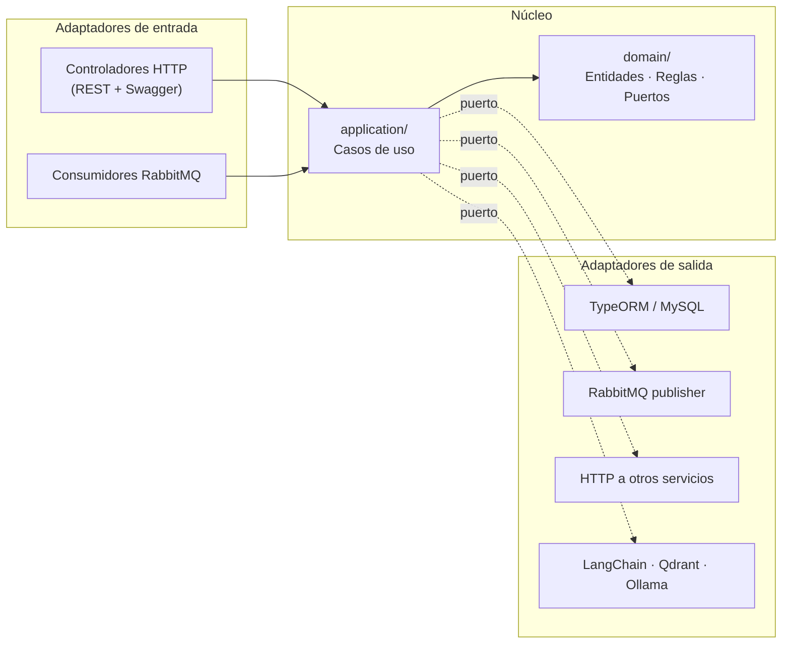
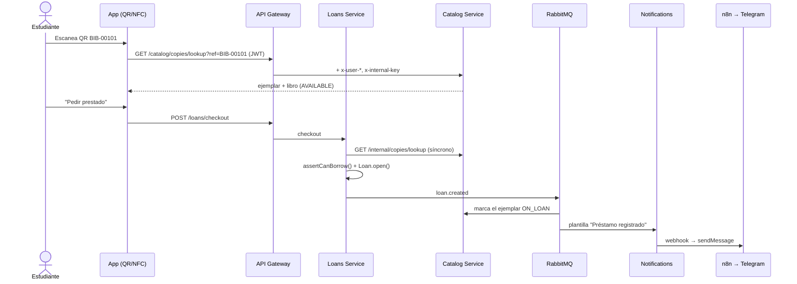
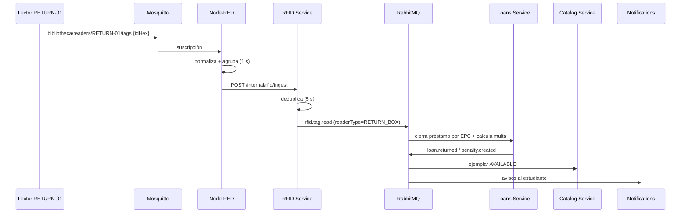
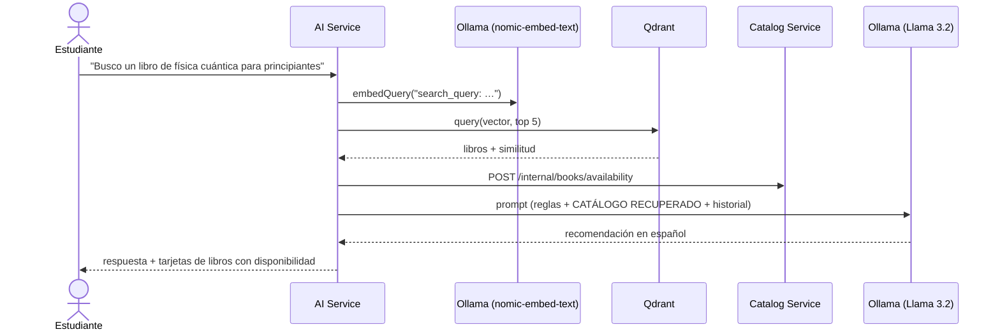

# Arquitectura de Bibliotheca AI

## 1. Estilo arquitectónico

Bibliotheca AI combina tres estilos:

1. **Microservicios por contexto delimitado (DDD)**: identidad, catálogo/activos, préstamos/sanciones, telemetría RFID, notificaciones e IA. Cada uno es dueño de sus datos (**una base de datos por servicio**) y se despliega por separado.
2. **Arquitectura hexagonal (puertos y adaptadores)** dentro de cada servicio: el dominio no conoce NestJS, MySQL, RabbitMQ ni LangChain.
3. **Arquitectura dirigida por eventos**: los servicios se comunican de forma asíncrona por RabbitMQ; solo hay llamadas síncronas cuando la respuesta es necesaria en ese instante (p. ej. préstamos consulta al catálogo si el ejemplar está disponible).

## 2. Capas hexagonales

La regla de dependencias apunta siempre hacia el dominio. Los puertos son interfaces TypeScript + un *token* de inyección (por ejemplo `LOAN_REPOSITORY`) y el *composition root* (`*.module.ts`) decide qué adaptador implementa cada puerto. Cambiar MySQL por PostgreSQL, o Ollama por OpenAI, es escribir otro adaptador sin tocar los casos de uso.

| Servicio | Agregados / reglas de dominio | Puertos de salida | Adaptadores |
|---|---|---|---|
| users | `User` (registro, roles, código de vinculación de Telegram con caducidad) | `UserRepository`, `PasswordHasher`, `TokenIssuer`, `EventPublisher` | TypeORM, bcrypt, JWT, RabbitMQ |
| catalog | `Book`, `Copy` (estados, etiqueta RFID, regla del arco, libro mal ubicado), `SecurityAlert` | `BookRepository`, `CopyRepository`, `AlertRepository`, `EventPublisher` | TypeORM, RabbitMQ |
| loans | `Loan` (vencimiento por rol, renovación), `Penalty`, `calculateFine`, `assertCanBorrow` | `LoanRepository`, `PenaltyRepository`, `CatalogGateway`, `UserDirectory`, `EventPublisher` | TypeORM, HTTP, RabbitMQ |
| rfid | `Reader` (en línea por latido), `TagRead`, `ReadDeduplicator` | `ReaderRepository`, `TagReadRepository`, `EventPublisher` | TypeORM, RabbitMQ |
| notifications | `Notification`, plantillas por evento | `RecipientRepository`, `NotificationRepository`, `ContactDirectory`, `NotificationSender` | TypeORM, HTTP, webhook de n8n |
| ai | `BookDocument`, `RecommendedBook`, umbral de relevancia, contexto para el LLM | `KnowledgeIndex`, `LanguageModel`, `CatalogSource` | LangChain (OllamaEmbeddings, ChatOllama, LCEL), Qdrant, HTTP |

## 3. Reglas de negocio principales

| Regla | Dónde vive |
|---|---|
| Préstamo de 7 días (estudiante) o 14 días (personal), vence a las 23:59 | `loans/domain/loan.ts` |
| Máximo 3 préstamos simultáneos para estudiantes | `loans/domain/borrowing-eligibility.ts` |
| No se presta con préstamos vencidos o multas pendientes | `loans/domain/borrowing-eligibility.ts` |
| Hasta 2 renovaciones de 7 días; no se renueva si está vencido o hay multas | `loans/domain/loan.ts` |
| Multa de $5 MXN por día (fracción = día completo), tope de $150 por préstamo | `loans/domain/penalty-calculator.ts` |
| Solo un ejemplar **prestado** puede cruzar el arco; si no, alerta | `catalog/domain/copy.ts` |
| Un ejemplar visto por un estante de otra zona está mal ubicado | `catalog/domain/copy.ts` |
| Una lectura por lector+etiqueta cada 5 s; lecturas "del futuro" se corrigen | `rfid/domain/read-deduplicator.ts`, `tag-read.ts` |
| Lector fuera de línea si no hay latido en 90 s | `rfid/domain/reader.ts` |
| El asistente solo recomienda libros recuperados del catálogo (similitud ≥ 0.35) | `ai/domain/model.ts` + prompt del adaptador |

Todos los valores se configuran en `.env` (`LOAN_DAYS_STUDENT`, `DAILY_FINE`, `RFID_DEDUP_WINDOW_MS`…).

## 4. Flujos principales

### 4.1 Autopréstamo con el celular

### 4.2 Devolución automática en el buzón RFID

### 4.3 Arco de seguridad

`rfid.tag.read` con `readerType = GATE` → catalog busca el ejemplar por EPC → si su estado no es `ON_LOAN` crea una `SecurityAlert` y publica `catalog.security_alert` → notifications la envía al chat del personal (`LIBRARY_ALERTS_CHAT_ID`) y la app la muestra en el monitor RFID.

### 4.4 Asistente virtual (RAG)

Si el LLM no responde, el servicio degrada a una respuesta construida solo con la búsqueda semántica. Los libros nuevos se indexan al recibir `catalog.book.created`; al arrancar, el servicio reintenta hasta que la colección esté completa.

### 4.5 Recordatorios y renovación en un clic

n8n (09:00 y 18:00) → `POST loans /internal/jobs/reminders` → `loan.due_soon` / `loan.overdue` → notifications → webhook n8n → Telegram con botón **🔄 Renovar** (`callback_data = renew:<loanId>`) → el flujo del bot recibe el *callback*, identifica al usuario por su `chat_id` y llama a `POST loans /internal/loans/:id/renew`.

## 5. Seguridad

- El cliente solo habla con el **API Gateway**. El gateway valida el JWT (HS256), **borra** cualquier cabecera `x-user-*` que venga del cliente y agrega la identidad verificada y la llave `x-internal-key`.
- Cada microservicio tiene un *guard* global que rechaza peticiones sin `x-internal-key` (comparación en tiempo constante) y valida roles con `@Roles('LIBRARIAN', 'ADMIN')`.
- Las rutas `/internal/*` (usadas por otros servicios, n8n y Node-RED) nunca se publican en el gateway.
- Contraseñas con bcrypt; códigos de vinculación de Telegram de un solo uso con caducidad de 15 minutos.
- Validación de entrada con `class-validator` en todos los DTO.

## 6. Modelo de datos (una base por servicio)

| Base | Tablas |
|---|---|
| `users_db` | `users` |
| `catalog_db` | `books`, `copies`, `security_alerts` |
| `loans_db` | `loans`, `penalties` |
| `rfid_db` | `readers`, `tag_reads` (serie temporal indexada por lector y fecha) |
| `notifications_db` | `recipients` (copia local por eventos), `notifications` |
| Qdrant | colección `bibliotheca_books` (vector por libro + ficha como *payload*) |

No hay llaves foráneas entre bases: la consistencia entre servicios es **eventual** y se mantiene con eventos. Los préstamos guardan una copia del título y del EPC para no depender del catálogo al consultar.

## 7. Decisiones técnicas

| Decisión | Motivo |
|---|---|
| MySQL por servicio + RabbitMQ | Coincide con el diagrama de referencia de la materia; aísla fallos y esquemas. |
| Qdrant en lugar de pgvector | Al usar MySQL no hay PostgreSQL donde instalar pgvector; Qdrant es la otra opción del documento y trae panel web para la demo. El puerto `KnowledgeIndex` permite cambiarlo. |
| Ollama local | Sin costo por uso y sin enviar datos de estudiantes a terceros; `LanguageModel` permite cambiar a OpenAI. |
| Bot por *long polling* en n8n | Funciona en `localhost` sin dominio público ni HTTPS. |
| Node-RED entre lectores y backend | Desacopla el protocolo/formato de cada fabricante (MQTT, JSON propietario) del dominio; agrupa lecturas para reducir carga. |
| Etiquetas HF ISO 15693 | Estándar de bibliotecas (ISO 28560) y legibles con el NFC de un Android. |
